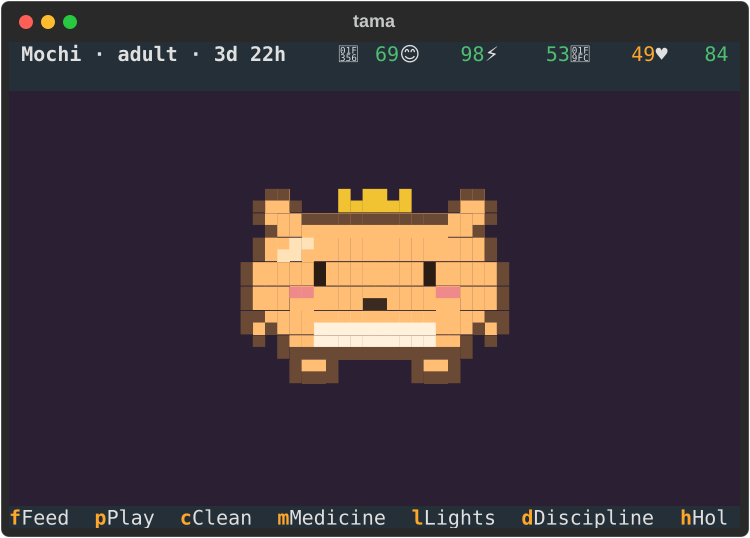
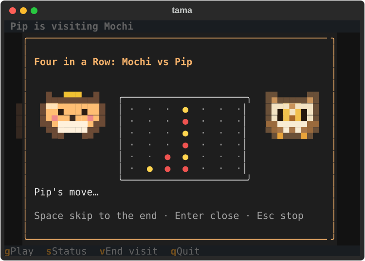
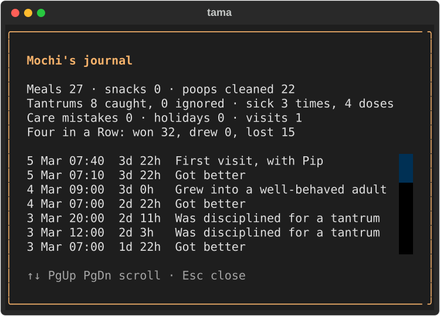

# tama

A terminal virtual pet. Hatch it, feed it, play with it, clean up after it — and come back
later to find it has been living while you were away.

<p>
  
  
  
</p>

Colour pixel art in any terminal of 60×20 or more. Several pets live side by side, visit each
other, keep a journal, learn tricks and grow old; a good elder leaves an egg for an heir.

## Install

Requires Python 3.12 or newer. Install the `tama` command with [uv](https://docs.astral.sh/uv/)
or [pipx](https://pipx.pypa.io/):

```sh
uv tool install git+https://github.com/BodneyC/tama
# or
pipx install git+https://github.com/BodneyC/tama
```

From a clone, `uv tool install .` (or `pipx install .`) does the same. To upgrade later,
`uv tool upgrade tama` or `pipx upgrade tama`.

## Playing

Keep up to nine pets. Each lives in real time whether or not tama is open, so check in on them.

```sh
tama                  # pick a pet (or hatch your first one)
tama --pet mochi      # open one pet straight away (any case, or the start of a name)
tama --new            # hatch another egg; --species owl (or bear) for a different animal
tama --status         # one line per pet, as of now (handy in a shell prompt)
tama journal          # a pet's journal from the shell (--pet NAME for another pet)
tama --pause          # going away? put every settled pet on holiday (--resume after)
```

In the game, `?` lists the keys: `f` feed, `p` play, `c` clean, `m` medicine, `l` lights,
`d` discipline, `w` wake, `s` status, `j` journal, `v` invite another pet over, `h` holiday,
`t` switch pets, `q` save and quit.

- **Needs:** hunger, happiness, energy and hygiene fall over time; sickness, poop and a tired
  pet need you too. Turn the lights off when it sleeps (its night is 22:00–07:00 by default).
- **Weight:** snacks cheer it up but fatten it, and games keep it trim (`s` shows its band).
- **Discipline:** catch its tantrums. A well-disciplined pet grows into a good adult and learns
  tricks (wave, spin, dance, bow) that it shows off when it's content.
- **Games:** Left/Right, Four in a Row and Tic-Tac-Toe against your pet, which plays better as
  it grows up. Invite another pet over (`v`) and watch the two of them play.
- **Journal:** every pet keeps one, written even while tama is closed (`j`).
- **Family:** a pet that dies of old age leaves an egg; its heir carries the name on (Mochi II).
- **Time of day:** the stage is tinted for dawn, day, dusk and night in your local time.

## Settings

An optional `config.toml` in your user config directory (`TAMA_CONFIG_PATH` to move it):

```toml
bell = false              # ring the terminal bell on new attention calls
reduced_motion = false    # static frames only (also --reduced-motion)
night_start = "22:00"
night_end = "07:00"
offline_cap_hours = 72    # how much time away is simulated; 0 freezes pets while closed
theme = "nord"            # any Textual theme
```

`NO_COLOR` is respected. Pets are saved in your user data directory (`TAMA_DATA_DIR` to move
it); saves are versioned, written atomically and backed up. `--save-path FILE` plays exactly one
save file instead, outside the pet list.

## Development

See [`CLAUDE.md`](CLAUDE.md) for commands and conventions, [`docs/`](docs/) for the design, and
[`CHANGELOG.md`](CHANGELOG.md) for what changed. The screenshots above come from
`uv run python -m tools.screenshots`.

## License

MIT
